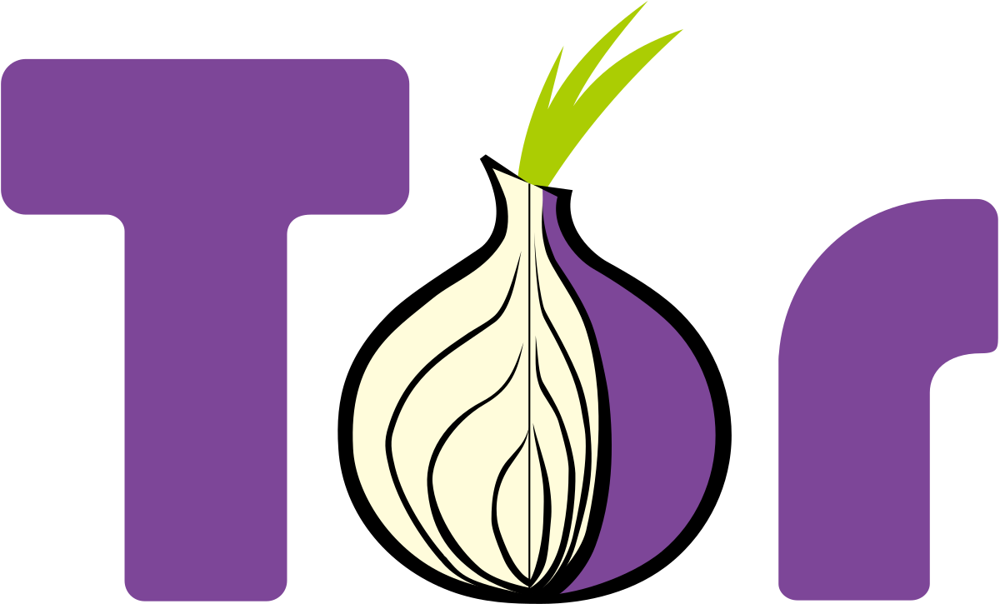

# meta-tor

OpenEmbedded/Yocto layer for Tor networking on embedded Linux systems.

<p align="center"></p>

| Recipe | Version | Purpose |
| --- | --- | --- |
| Tor | 0.4.9.16 | C implementation of Tor, including onion services and relays |
| Arti | 2.8.0 | Rust implementation of Tor |
| torsocks | 2.5.0 | Run compatible applications through a Tor SOCKS proxy |

The layer targets **Yocto 6.0 (Wrynose)**.

## Build

The supplied [kas configuration](kas-tor.yml) includes the required repositories
and uses `nodistro` with systemd.

To integrate into an existing Wrynose build, add `meta-tor` and `meta-oe` alongside
OE-Core in `BBLAYERS`, then select the packages you need:

```bitbake
IMAGE_INSTALL:append = " tor"
```

Arti and torsocks can also be selected with `IMAGE_INSTALL`.
The demo image additionally requires `meta-webserver` and its layer dependencies.

To build the demo image using [kas](https://kas.readthedocs.io/):

```sh
KAS_MACHINE=qemux86-64 kas build kas-tor.yml
```

Or use the kas container wrapper:

```sh
KAS_MACHINE=qemux86-64 kas-container build kas-tor.yml
```

The demo enables passwordless root login. Remove the corresponding
`EXTRA_IMAGE_FEATURES` in `kas-tor.yml` and configure authentication for deployment.

## Run in QEMU

After building the QEMU image, run:

```sh
KAS_MACHINE=qemux86-64 kas shell kas-tor.yml -c 'runqemu kvm serialstdio nographic snapshot'
```

This command requires host KVM access.

## Tor and Arti services

Tor is enabled by default. Arti is installed in the demo image but its service is
disabled by default. Both use SOCKS port 9050; run one at a time.

To switch to Arti on the target, run as root:

```sh
systemctl disable --now tor.service
systemctl enable --now arti.service
```

Configure Arti in [/etc/arti/arti.toml](recipes-tor/arti/arti/arti.toml).

## Onion services and remote access

Tor onion services allow inbound connections even behind NAT. They are disabled
in the supplied [torrc](recipes-tor/tor/tor/torrc).

To enable them, uncomment `HiddenServiceDir` and at least one `HiddenServicePort`
in `/etc/tor/torrc`. For example, to expose local SSH and HTTP services:

```text
HiddenServiceDir /var/tor/hidden_service
HiddenServicePort 22 127.0.0.1:22
HiddenServicePort 80 127.0.0.1:80
```

Only enable the ports you intend to expose, and ensure the corresponding local
services are running. Tor rejects a `HiddenServiceDir` with no configured ports.

Restart Tor and read the generated onion address on the target as root:

```sh
systemctl restart tor.service
cat /var/tor/hidden_service/hostname
```

From another machine running a Tor SOCKS proxy and torsocks, substitute that
address and an account configured on the target:

```sh
torsocks ssh username@your-service.onion
torsocks wget http://your-service.onion
```

You can also access HTTP/HTTPS onion services with
[Tor Browser](https://www.torproject.org/download/).

## Tor Relay

The supplied [/etc/tor/torrc.relay](recipes-tor/tor/tor/torrc.relay) is a non-exit
relay example (`ExitRelay 0`). Set your nickname, contact information, and
bandwidth limits, then configure `tor.service` to read this file instead of
`/etc/tor/torrc`. Reload systemd after changing the unit and restart Tor.

A public relay advertises its IP address. The relay example disables the local
SOCKS proxy with `SocksPort 0`.
